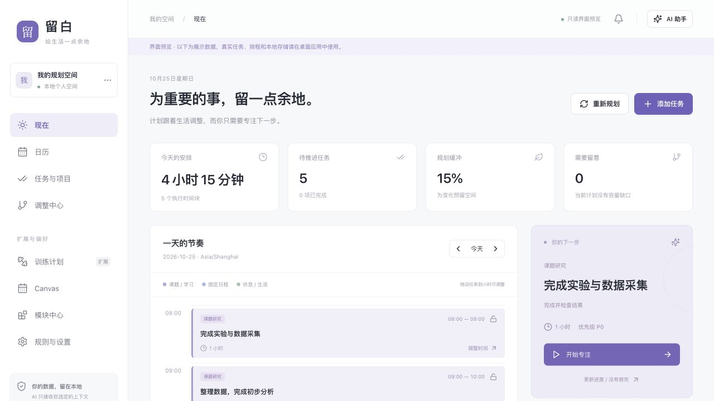
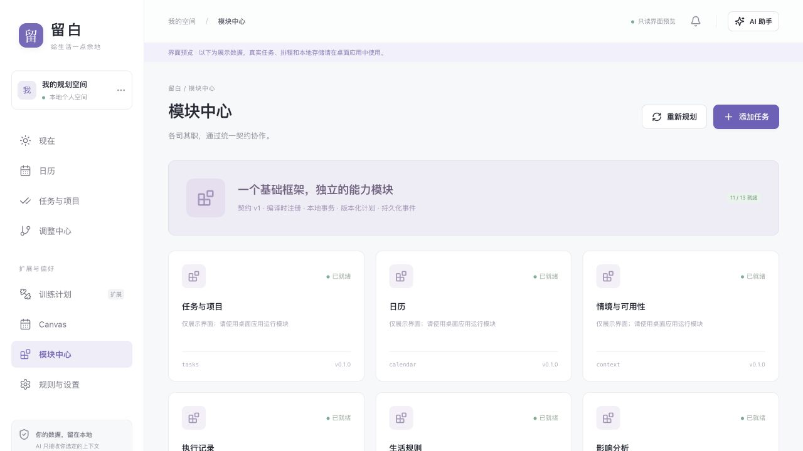
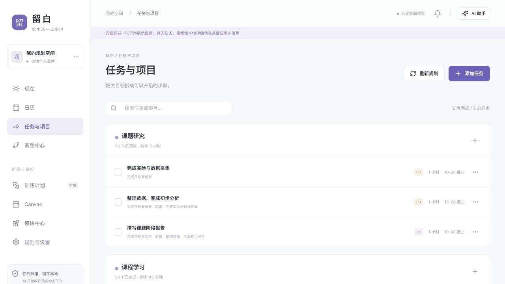

# 留白｜模块化个人规划原型

留白是一个本地优先的 macOS 学生日程与任务规划原型。我希望它帮助学生把任务、课表和实际执行连接起来：一件事没有按预计完成时，能够重新检查后续安排，并看清哪些任务受到影响。

本仓库保存现有 0.1.0 版本的源码、示例界面、设计说明和 Mac 应用。项目目前暂停推进；2026 年 10 月的工作是整理与复盘现有版本，没有新增功能或新的完整运行验收。

## 个人贡献与 AI 协作

我提出使用需求、动态调整与模块化要求，并参与方案取舍；AI 协助架构细化与代码实现。现有结构将任务、课程、执行反馈、排程和变化影响等能力分成独立模块，通过统一约定协作。模块化是我目前最满意的部分，方便理解各部分负责什么，也为后续调整保留空间。

前期调试与排错的成本较高，做出原型后我尚未继续推进。这次先整理已经留下的内容，复盘需求、调试成本和下一步优先级，再决定后续范围。

## 项目进展

| 时间 | 进展 |
| --- | --- |
| 2026 年 9 月 | 开始开发留白。起始时间根据本人陈述及项目存档说明整理。 |
| 2026 年 10 月 | 找回源码与应用，整理作品说明、示例截图和公开仓库；当前仍处于复盘阶段。 |

本仓库的公开提交记录从这次整理开始，不补造历史 Git 提交。存档中的测试和操作记录单独保留，不能等同于本次重新验证。

2026 年 10 月 25 日的[首次 GitHub 自动检查](https://github.com/Funnyyanng/liubai-planner/actions/runs/40174353884)在安装依赖（`npm ci`）时报告 `Invalid Version`，后续构建和测试尚未执行；该结果作为待复盘的调试卡点保留。本次没有据此改动原型源码。

## 查看作品

- [原型与设计说明 PDF](docs/portfolio/留白_原型与设计说明.pdf)
- [现有原型 0.1.0：源码与 Mac 应用 ZIP](downloads/留白_原型0.1.0_源码与Mac应用.zip)
- [架构与模块约定](docs/ARCHITECTURE.md)
- [原有验证记录与当前边界](docs/VALIDATION.md)

ZIP 中包含现有源码、Mac 应用、作品说明和示例截图，不包含个人数据库或 API 凭据。Mac 应用为 Apple Silicon 本机开发构建，未进行 Apple Developer 签名、公证或跨平台验证。

## 示例界面

以下截图来自浏览器中的内置演示数据，用来展示已有界面，不是个人真实日程，也不是本次执行排程或连接模型的结果。日期随预览当天生成；浏览器预览不会执行 Rust 排程或访问本地数据库。

### 日程与当前任务



### 模块中心



界面中的模块状态来自演示数据，不代表本次对各模块进行了运行验收。

### 任务与前置依赖



示例中的实验、数据分析和报告存在前置关系。浏览器预览未触发真实执行反馈或延期重排。

## 现有版本的使用流程

目标、课程、实际执行和动态重排通过独立模块协作；云端 AI 仅生成待确认草案，时间冲突和依赖由本地引擎校验。AI 接口与校验流程已写入代码，真实云模型端到端效果尚未验证。

打开交付的 **留白.app**。首次启动是空工作区，可以手动添加任务，也可以点击「载入体验数据」了解实验、分析、报告之间的延期连锁关系。体验数据只允许加入空工作区。

1. 在「规则与设置」设置作息、设备、时区和生活保留时间。
2. 添加课程或导入 ICS；日历中可将单次课程改为「专注听课／部分可用／自主可用」。
3. 创建任务，填写剩余时间、截止时间、完成标准和前置依赖。
4. 查看「现在」中的可执行建议，开始专注；结束后确认完成、剩余时间或阻碍。
5. 在「调整中心」查看因果链、变更前后时间和未安排工作。撤销仅恢复仍然可行的安排，执行事实不会被删除。
6. 启用训练模块后，训练频次与恢复间隔通过统一约束加入滚动计划。

没有真实模型密钥时，所有本地任务、课表和排程功能仍可使用。AI 需要在设置中填写完整 HTTPS Chat Completions 接口地址、模型名称和自己的 API 密钥。密钥保存至 macOS 钥匙串。每次请求默认不发送已有任务或课程；由用户勾选上下文。

## 本地开发

需要 Node.js 24、Rust stable 和 macOS Command Line Tools。仓库不包含 Rust 工具链，全新克隆后需自行安装。脚本在找到原开发环境的隔离工具链时会优先使用，否则使用系统 Rust。

```sh
npm ci
npm run desktop:dev
```

`npm run dev` 只启动**只读浏览器界面预览**，展示示例数据，不执行 SQLite 或 Rust 排程。真实业务请运行桌面应用。

```sh
npm run build                  # 模块边界、TypeScript、前端构建
npm test                       # 前端测试
npm run check:rust             # Rust 工作区测试
node scripts/rust.mjs clippy --workspace --all-targets -- -D warnings
node scripts/rust.mjs fmt --all -- --check
npm run desktop:build          # 生成 macOS app
```

构建结果在 `target/release/bundle/macos/留白.app`。当前交付针对 Apple Silicon；源码保留跨平台结构，Windows/Linux 打包与凭据后端尚未验证。

## 工程布局

```text
src/                  React 应用外壳、页面注册、独立功能界面
src-tauri/            Tauri 命令适配、系统对话框和桌面生命周期
crates/contracts/     无业务实现依赖的公共类型与错误契约
crates/framework/     注册与生命周期、模块存储、事务、事件、平台能力
modules/              14 个独立 Rust 业务包
modules.json          编译时模块注册表
scripts/              构建、架构边界检查与开发辅助
.github/workflows/    macOS CI
```

- [交大 Canvas 接入](docs/CANVAS.md)
- [架构与模块契约](docs/ARCHITECTURE.md)
- [如何新增模块](docs/EXTENDING.md)
- [验证与当前边界](docs/VALIDATION.md)

## 数据与当前边界

- 数据存于 macOS Application Support 下的 `local.liubai.planner/planner.sqlite`，设置页可备份和恢复。开发测试可通过 `LIUBAI_DATA_DIR` 指定独立数据目录。
- 数据库迁移前自动备份；恢复前保留现有数据备份。恢复版本不匹配时明确拒绝。
- 应用关闭或电脑休眠时不持续调度；恢复运行后检查过期时间块，不把任务自动标记完成。
- ICS 第一版支持独立事件、全天事件、带 `UNTIL` 的周重复、隔周、`EXDATE` 和时区。不支持的规则（如 `COUNT`、月重复、`RECURRENCE-ID`）整批拒绝，不静默丢失事件。
- 排程使用确定性启发式，并非全局最优求解器。排不下时说明当前未找到可行安排，不伪造成功，也不自行牺牲锁定安排或生活保障。
- 第一版模块随应用发布；不是第三方代码沙箱，也没有插件市场。
- 当前应用包为本机开发构建，未进行 Apple Developer 签名与公证。
