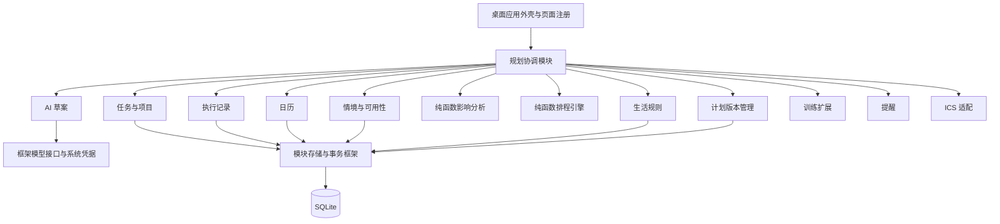

# 架构与契约

## 协作方式

任务与课程是真实业务数据，时间块是可变的安排，执行记录是已经发生的事实。三者不可互相替代。

## 模块注册与生命周期

`modules/<id>/manifest.json` 与根 `modules.json` 必须一致。框架检查唯一标识、契约版本、必需依赖和循环依赖，按拓扑顺序初始化、逆序关闭。每个注册项带初始化和关闭回调；无常驻资源的模块关闭回调为空操作。

可选模块初始化失败被记录为 failed，核心仍可使用。核心存储／任务初始化失败时进入诊断模式，禁止业务写入，允许从备份恢复。配置未启用与初始化失败分别表示为 disabled 与 failed。

Cargo 独立包约束私有实现可见性；边界检查拒绝未声明包依赖、跨模块仓储名称和业务层直接使用网络、SQL、凭据或进程接口。编译期注册并不构成不可信代码安全隔离。

## 公共契约

契约版本为 1，时间统一使用 **Unix 分钟**，日历展开展示时使用配置的 IANA 时区。

- `WorkDemand`：任务快照与最早开始时间。任务包含剩余工作量、截止时间、优先级、依赖和执行条件。
- `AvailabilityWindow`：可用区间、可承受专注等级、是否仅允许可中断任务、设备及地点。
- `Constraint`：固定占用、允许时段、依赖、连续时长、执行条件、任务间隔与周期配额。未知类型在反序列化时拒绝；未知任务引用在校验时拒绝。v1 中前六类是硬约束，配额是可报告缺口的目标。
- `PlanningSnapshot`：输入版本、当前时间、窗口终点、任务、窗口、约束、已有时间块及完成任务集合。
- `PlanProposal`：输入版本、候选时间块、未安排工作、风险、变更差异和授权状态。
- `ImpactReport`：触发源、受影响任务、依赖／竞争传播边和风险。

模型输出由 `AiDraft` 限制为新增任务、剩余估时建议和注意力模式建议。已有截止时间及任务完成状态不能由模型直接改写。

## 数据所有权与事务

每个模块使用自己的 `<module>_records` 表，包含主键及 JSON payload。v1 使用稳定类型契约承载模块数据，避免前期大量跨表耦合；扩展时可通过显式迁移增加模块专有结构。

模块只在自身公开函数内请求自己命名空间的仓储。协调模块调用公开函数，不能查询对方表。多个公开写操作可共享 `UnitOfWork`：例如执行记录、任务剩余量和变更事件在同一事务内提交或回滚。

框架表提供：

- 全局递增输入版本；提交前拒绝旧快照。
- 幂等命令结果；重试同一命令不会重复记录执行。
- 持久化 outbox；业务状态与事件一起写入，重启后可读取未处理事件。
- 处理确认和失败次数；失败事件最多重试三次。
- 变更审计、每模块迁移版本和整库备份。

恢复备份时新版本号大于恢复前和备份中的版本，防止旧 AI 请求恰好命中复用的版本号。前端不使用 localStorage 保存真实任务。

## 规划与偏差处理

1. 执行反馈更新事实，不从计时推断任务完成。
2. 协调器读取不可变快照；训练模块先通过任务公开接口补足本周期需求。
3. 日历按本地时间展开，情境模块切分窗口，生活模块排除保护区间并预留缓冲。
4. 排程优先保留合法现有时间块，再按优先级、截止时间和依赖补排；若未安排工作较多，比较完整重排结果。
5. 影响模块从变化任务出发，传播前置关系与新安排对原时间块的竞争，追踪到不再新增受影响任务。
6. 校验器独立检查重叠、依赖、连续时长、工作量守恒和受保护安排。
7. 合法的普通调整原子应用。锁定或正在执行的安排冲突时，保留上次计划并显示“最新计划尚未生成”，让用户明确处理。

计算按当天／14 天滚动窗口执行。每次启发式求解有时间预算，超时保留已校验的部分并报告剩余工作。大于窗口的任务仍保留截止时间，未安排不等同于已经错过截止时间。

正在执行的时间块过期后等待反馈，不自动延长或侵占下一个时间段。部分可用课堂只允许匹配条件的任务；“现在”推荐额外要求真实前置任务已经完成。

## AI 与桌面平台

AI 网络请求使用框架 `ModelTransport`，生产实现 `HttpModel` 只允许 HTTPS、禁止自动重定向、45 秒超时、限制输出长度、每日调用上限与一分钟冷却。失败保留现有计划；结构不合法的输出不会写入任务。

实际网络请求仅包含用户选择的任务／日历及当前请求。模型密钥保存在系统钥匙串，不能由前端读取。外部模型未配置时，规则排程不受影响。

Tauri 适配层提供原生文件对话框、备份恢复、通知和后台阻塞任务执行。界面恢复焦点／每分钟检查过期安排，编辑对话框打开时避免自动写入打断正在编辑的版本。
